<div align="center">

<!-- Language Switcher Pills -->
<p align="center">
  <a href="README.md">
    <picture>
      <source media="(prefers-color-scheme: dark)" srcset="docs/readme/lang-ru-inactive-dark.svg">
      
    </picture>
  </a>
  &nbsp;
  <picture>
    <source media="(prefers-color-scheme: dark)" srcset="docs/readme/lang-en-active-dark.svg">
    
  </picture>
</p>

<!-- Hero Header Card -->
<picture>
  <source media="(prefers-color-scheme: dark)" srcset="docs/readme/hero-en-dark.svg">
  
</picture>

<br>

<!-- Rounded Material 3 Pill Action Strip -->
<p align="center">
  <a href="https://github.com/MoltenSt4r/MoltenGram-Desktop/releases/latest">
    <picture>
      <source media="(prefers-color-scheme: dark)" srcset="docs/readme/pill-download-en-dark.svg">
      
    </picture>
  </a>
  &nbsp;
  <a href="https://t.me/MoltenGram">
    <picture>
      <source media="(prefers-color-scheme: dark)" srcset="docs/readme/pill-channel-dark.svg">
      
    </picture>
  </a>
  &nbsp;
  <a href="https://t.me/MoltenGramBot">
    <picture>
      <source media="(prefers-color-scheme: dark)" srcset="docs/readme/pill-chat-dark.svg">
      
    </picture>
  </a>
  &nbsp;
  <a href="https://www.moltenstar.space">
    <picture>
      <source media="(prefers-color-scheme: dark)" srcset="docs/readme/pill-website-dark.svg">
      
    </picture>
  </a>
  &nbsp;
  <a href="LICENSE">
    <picture>
      <source media="(prefers-color-scheme: dark)" srcset="docs/readme/pill-license-dark.svg">
      
    </picture>
  </a>
</p>

<!-- Live Release & Downloads Badges -->
<p align="center">
  <a href="https://github.com/MoltenSt4r/MoltenGram-Desktop/releases/latest"></a>
  <a href="https://github.com/MoltenSt4r/MoltenGram-Desktop/releases"></a>
  <a href="https://github.com/MoltenSt4r/MoltenGram-Desktop/stargazers"></a>
  <a href="LICENSE"></a>
</p>

<p align="center">
  Modified cross-platform Telegram client for <b>Windows</b>, <b>Linux</b>, and <b>macOS</b> built from
  <a href="https://github.com/telegramdesktop/tdesktop">Telegram Desktop</a> and
  <a href="https://github.com/metawka/exDesktop">exDesktop</a>.<br>
  Signature <b>Material Design 3 Expressive</b> aesthetics, the full MoltenGram feature suite (Wave 1 &amp; Wave 2), deep privacy controls, sandboxed plugins, and Streamer Mode.
</p>

<br>

<!-- Wave 1 & Wave 2 MD3 Expressive Feature Card -->
<picture>
  <source media="(prefers-color-scheme: dark)" srcset="docs/readme/features-wave-en-dark.svg">
  
</picture>

<br>

<!-- Platforms & Architecture Card -->
<a href="https://github.com/MoltenSt4r/MoltenGram-Desktop/releases/latest">
  <picture>
    <source media="(prefers-color-scheme: dark)" srcset="docs/readme/platforms-en-dark.svg">
    
  </picture>
</a>

</div>

---

## Install MoltenGram Desktop

### One-Line Install on Linux / macOS

```bash
curl -fsSL https://raw.githubusercontent.com/MoltenSt4r/MoltenGram-Desktop/main/install.sh | sh
```

### Platform Downloads

| Platform | Release Files | Notes |
|:--|:--|:--|
| **Windows (x64)** | `MoltenGram-Desktop-setup-x64.*.exe`<br>`MoltenGram-Desktop-portable-x64.*.zip` | Installer or portable archive, built-in `tg-ws-proxy` |
| **Linux (x64)** | `MoltenGram-Desktop-linux-x64.*.tar.gz` | Extract and run `MoltenGram-Desktop` (or use `install.sh`) |
| **macOS (Apple Silicon)** | `MoltenGram-Desktop-macos-arm64.*.dmg`<br>`MoltenGram-Desktop-macos-arm64.*.zip` | Native Apple Silicon (arm64) build, `install.sh` supported |

All binaries and checksums are available on the [releases page](https://github.com/MoltenSt4r/MoltenGram-Desktop/releases/latest).

---

## Complete Feature Overview

<details>
<summary><b>✨ Explore all categories (Visuals, Messages, Audio, Privacy, Network, Plugins)</b></summary>

<table>
  <tr>
    <td width="50%" valign="top">
      <h3>Appearance &amp; Material 3 Expressive</h3>
      <ul>
        <li>Material Design 3 Expressive &amp; Smooth Scrolling</li>
        <li>44 MD3 avatar shapes &amp; 27-icon custom app icon pack</li>
        <li>Frosted Glass message bubbles</li>
        <li>MD3 media carousel &amp; expressive MD3 QR generator</li>
        <li>Bot-based profile styling &amp; PillStack profile badges</li>
        <li>Deep customization &amp; hiding of Telegram Desktop UI elements</li>
      </ul>
    </td>
    <td width="50%" valign="top">
      <h3>Messages, Input &amp; Media</h3>
      <ul>
        <li>Voice Changer with real-time presets while recording</li>
        <li>SongRec — instant music recognition via Shazam / AudD</li>
        <li>NowPlaying live track status (Last.fm integration)</li>
        <li>Local playlists inside the full-screen audio player</li>
        <li>Colored text, custom autocomplete commands &amp; smart URL cleaner</li>
        <li>Configurable Double-Tap actions, QuoteReply &amp; saved deleted quotes</li>
        <li>Input field calculator, character counter, video notes &amp; formatting-preserving translation</li>
      </ul>
    </td>
  </tr>
  <tr>
    <td width="50%" valign="top">
      <h3>Privacy &amp; Control</h3>
      <ul>
        <li>AyuGram features: ghost mode, saving deleted messages &amp; edit history</li>
        <li>MTProto Device Spoofing (custom model / OS fingerprint)</li>
        <li>Deeply configurable Streamer Mode</li>
        <li>No account limit &amp; removal of Telegram restrictions</li>
        <li>Hide phone number, show user IDs, registration dates &amp; hidden group members</li>
      </ul>
    </td>
    <td width="50%" valign="top">
      <h3>Network, Plugins &amp; AI</h3>
      <ul>
        <li>Built-in <code>tg-ws-proxy</code> (Windows) &amp; faster downloads/uploads</li>
        <li>Compatible plugin engine for <code>.plugin</code> / <code>.elyx</code> / <code>.eaf</code> formats</li>
        <li>Local sandbox &amp; global plugin permission controls</li>
        <li>PluginGuard vector security model &amp; malicious plugin blocker</li>
        <li>Built-in AI plugin porting assistant &amp; AI Chat [beta]</li>
        <li>Local Telegram Premium, custom notifications &amp; automatic updates</li>
      </ul>
    </td>
  </tr>
</table>

</details>

<details>
<summary><b>🖼️ Interface Screenshots</b></summary>

<br>

<table>
  <tr>
    <td width="50%"></td>
    <td width="50%"></td>
  </tr>
  <tr>
    <td width="50%"></td>
    <td width="50%"></td>
  </tr>
  <tr>
    <td width="50%"></td>
    <td width="50%"></td>
  </tr>
  <tr>
    <td width="50%"></td>
    <td width="50%"></td>
  </tr>
  <tr>
    <td width="50%"></td>
    <td width="50%"></td>
  </tr>
</table>

</details>

---

## Building from Source

<details>
<summary><b>🔑 Telegram API Credentials</b></summary>

Get your own API ID and hash on [Telegram's API credentials page](https://core.telegram.org/api/obtaining_api_id). Pass them to CMake or `configure.py`:

```bash
-D TDESKTOP_API_ID=YOUR_API_ID -D TDESKTOP_API_HASH=YOUR_API_HASH
```

</details>

<details>
<summary><b>🐧 Building on Linux</b></summary>

**Dependencies**

- CMake 3.16+ and a C++20 compiler (GCC 12+ or Clang 15+)
- Qt 6: Core, Gui, Widgets, Network, OpenGL, DBus, Wayland, Svg, ImageFormats
- Python 3.11–3.14 development headers (`python3-dev` / `dev-lang/python`)
- Telegram Desktop libraries: `tg_owt`, `ffmpeg`, `openal`, `opus`, `rnnoise`, `libjpeg-turbo`, `xxhash`, `minizip`, `ada`, `cld3`, `wallet-engine-telegram`

**Build with CMake**

```bash
cmake -B build -G Ninja \
    -DCMAKE_BUILD_TYPE=Release \
    -DQT_VERSION_MAJOR=6 \
    -DDESKTOP_APP_DISABLE_QT_PLUGINS=ON \
    -DTDESKTOP_API_ID="YOUR_API_ID" \
    -DTDESKTOP_API_HASH="YOUR_API_HASH"

cmake --build build --target Telegram
```

**Python plugin runtime**

```bash
sudo mkdir -p /usr/share/MoltenGram-Desktop/python/extera
sudo cp -r Telegram/SourceFiles/extera/python/* /usr/share/MoltenGram-Desktop/python/extera/
```

</details>

<details>
<summary><b>🪟 Building on Windows</b></summary>

1. Follow the [Telegram Desktop Windows build guide](https://github.com/telegramdesktop/tdesktop/blob/dev/docs/building-win.md).
2. Place the embedded Python 3.11 runtime in `Libraries/win64/python311` (headers, `python311.lib`, and `embed` folder).
3. Generate project files with your API ID and hash:

```cmd
python configure.py x64 -D TDESKTOP_API_ID=YOUR_API_ID -D TDESKTOP_API_HASH=YOUR_API_HASH
```

4. Build the `Telegram` target:

```cmd
cmake --build out --config Release --target Telegram
```

The `python` folder next to `Telegram.exe` is required for plugins.

</details>

---

## Credits

| Project | Use in MoltenGram Desktop |
|:--|:--|
| [Telegram Desktop](https://github.com/telegramdesktop/tdesktop) | Client sources |
| [exDesktop](https://github.com/metawka/exDesktop) | Upstream desktop fork |
| [exteraGram](https://github.com/exteraSquad/exteraGram) | Features and plugin format |
| [AyuGram Desktop](https://github.com/AyuGram/AyuGramDesktop) | Desktop implementation references |
| [tg-ws-proxy](https://github.com/Flowseal/tg-ws-proxy) | Built-in WebSocket proxy, MIT License |
| [Kangel Plugins Manager](https://git.kangel.xyz/KangelPlugins/PluginManager) | Plugin security check approach and the PluginGuard vector model |

<details>
<summary><b>📚 Third-Party Libraries and Components</b></summary>

- [Telegram Desktop](https://github.com/telegramdesktop/tdesktop): client sources, GPL-3.0 with an OpenSSL linking exception
- desktop-app libraries: [lib_base](https://github.com/desktop-app/lib_base), [lib_rpl](https://github.com/desktop-app/lib_rpl), [lib_crl](https://github.com/desktop-app/lib_crl), [lib_storage](https://github.com/desktop-app/lib_storage), [lib_tl](https://github.com/desktop-app/lib_tl), [lib_lottie](https://github.com/desktop-app/lib_lottie), [lib_spellcheck](https://github.com/desktop-app/lib_spellcheck), [lib_qr](https://github.com/desktop-app/lib_qr), [lib_webrtc](https://github.com/desktop-app/lib_webrtc), [lib_webview](https://github.com/desktop-app/lib_webview), [lib_translate](https://github.com/desktop-app/lib_translate), [cmake_helpers](https://github.com/desktop-app/cmake_helpers): GPL-3.0 with an OpenSSL linking exception
- [lib_ui](https://github.com/metawka/lib_ui): fork with exDesktop changes, GPL-3.0 with an OpenSSL linking exception
- [codegen](https://github.com/metawka/codegen): fork with exDesktop changes, GPL-3.0 with an OpenSSL linking exception
- [Qt 6](https://github.com/qt/qtbase): LGPL-3.0 or GPL-3.0
- [OpenSSL 3](https://github.com/openssl/openssl): Apache-2.0
- [WebRTC (tg_owt)](https://github.com/desktop-app/tg_owt): BSD-3-Clause
- [FFmpeg](https://ffmpeg.org): LGPL-2.1-or-later
- [OpenAL Soft](https://github.com/kcat/openal-soft): LGPL
- [Opus](https://github.com/xiph/opus): BSD-3-Clause
- [RNNoise](https://github.com/xiph/rnnoise): BSD-3-Clause
- [libjpeg-turbo](https://github.com/libjpeg-turbo/libjpeg-turbo): IJG, BSD-3-Clause
- [zlib and minizip](https://zlib.net): zlib
- [LZMA SDK](https://www.7-zip.org/sdk.html), [liblzma](https://tukaani.org/xz/): public domain
- [Breakpad](https://chromium.googlesource.com/breakpad/breakpad): BSD-3-Clause
- [Crashpad](https://crashpad.chromium.org): Apache-2.0
- [Ada](https://github.com/ada-url/ada): Apache-2.0
- [CLD3](https://github.com/google/cld3): Apache-2.0
- [tgcalls](https://github.com/TelegramMessenger/tgcalls): LGPL-3.0
- [CMake](https://cmake.org): BSD-3-Clause
- [Ninja](https://ninja-build.org): Apache-2.0
- [GSL](https://github.com/Microsoft/GSL): MIT
- [range-v3](https://github.com/ericniebler/range-v3): BSL-1.0
- [expected](https://github.com/TartanLlama/expected): CC0-1.0
- [xxHash](https://github.com/Cyan4973/xxHash): BSD-2-Clause
- [LZ4](https://github.com/lz4/lz4): BSD-2-Clause
- [QR Code generator](https://github.com/nayuki/QR-Code-generator): MIT
- [zxcvbn-c](https://github.com/tsyrogit/zxcvbn-c): MIT
- [Hunspell](https://github.com/hunspell/hunspell): LGPL-2.1, MPL-1.1 or GPL-2.0
- [libcbor](https://github.com/PJK/libcbor): MIT
- [libfido2](https://github.com/Yubico/libfido2): BSD-2-Clause
- [cmark-gfm](https://github.com/desktop-app/cmark-gfm): BSD-2-Clause
- [MicroTeX](https://github.com/desktop-app/MicroTeX): MIT
- [libprisma](https://github.com/desktop-app/libprisma): MIT
- [TooManyCooks](https://github.com/tzcnt/TooManyCooks): BSL-1.0
- [litehtml](https://github.com/litehtml/litehtml): BSD-3-Clause
- [Gumbo](https://github.com/google/gumbo-parser): Apache-2.0
- [QuickJS-ng](https://github.com/quickjs-ng/quickjs): MIT
- [twidget](https://github.com/TelegramMessenger/twidget): BSD-3-Clause
- [widget-sandbox](https://github.com/TelegramMessenger/widget-sandbox): BSD-3-Clause
- [KImageFormats](https://github.com/KDE/kimageformats): LGPL-2.0-or-later
- [KCoreAddons](https://github.com/KDE/kcoreaddons): LGPL-2.1-or-later
- [nimf](https://github.com/hamonikr/nimf): LGPL-3.0
- [fcitx5-qt](https://github.com/fcitx/fcitx5-qt): LGPL-2.1-or-later
- [hime](https://github.com/hime-ime/hime): LGPL-2.1
- [xdg-desktop-portal](https://github.com/flatpak/xdg-desktop-portal): LGPL-2.1-or-later
- [Open Sans](https://github.com/googlefonts/opensans): Apache-2.0
- [Vazirmatn](https://github.com/rastikerdar/vazirmatn): OFL-1.1
- [Material Symbols](https://github.com/google/material-design-icons): Apache-2.0
- [materialgram](https://github.com/materialgram/materialgram): icons, GPL-3.0
- [Emoji alpha codes](https://github.com/emojione/emojione): MIT
- [FrequencyWords](https://github.com/hermitdave/FrequencyWords) by Hermit Dave: CC BY-SA 4.0
- [Python 3.11 (CPython)](https://github.com/python/cpython): PSF-2.0
- [tg-ws-proxy](https://github.com/Flowseal/tg-ws-proxy): MIT, sources in `Telegram/SourceFiles/extera/tgws`
- [cryptography](https://github.com/pyca/cryptography): Apache-2.0 or BSD-3-Clause
- [h2](https://github.com/python-hyper/h2): MIT
- [httpx](https://github.com/encode/httpx): BSD-3-Clause
- [certifi](https://github.com/certifi/python-certifi): MPL-2.0
- [exteraGram](https://github.com/exteraSquad/exteraGram): GPL-2.0
- [AyuGram Desktop](https://github.com/AyuGram/AyuGramDesktop): GPL-3.0

</details>

<br>

<div align="center">

<!-- GPL-3.0 FOSS Footer Card -->
<a href="LICENSE">
  <picture>
    <source media="(prefers-color-scheme: dark)" srcset="docs/readme/footer-en-dark.svg">
    
  </picture>
</a>

<br>

<!-- Expressive Wave Footer -->
<picture>
  <source media="(prefers-color-scheme: dark)" srcset="docs/readme/wave-dark.svg">
  
</picture>

</div>
