<div align="center">

<!-- Language Switcher Pills -->
<p align="center">
  <picture>
    <source media="(prefers-color-scheme: dark)" srcset="docs/readme/lang-ru-active-dark.svg">
    
  </picture>
  &nbsp;
  <a href="README.en.md">
    <picture>
      <source media="(prefers-color-scheme: dark)" srcset="docs/readme/lang-en-inactive-dark.svg">
      
    </picture>
  </a>
</p>

<!-- Hero Header Card -->
<picture>
  <source media="(prefers-color-scheme: dark)" srcset="docs/readme/hero-ru-dark.svg">
  
</picture>

<br>

<!-- Rounded Material 3 Pill Action Strip -->
<p align="center">
  <a href="https://github.com/MoltenSt4r/MoltenGram-Desktop/releases/latest">
    <picture>
      <source media="(prefers-color-scheme: dark)" srcset="docs/readme/pill-download-ru-dark.svg">
      
    </picture>
  </a>
  &nbsp;
  <a href="https://t.me/MoltenGram">
    <picture>
      <source media="(prefers-color-scheme: dark)" srcset="docs/readme/pill-channel-dark.svg">
      
    </picture>
  </a>
  &nbsp;
  <a href="https://t.me/MoltenGramBot">
    <picture>
      <source media="(prefers-color-scheme: dark)" srcset="docs/readme/pill-chat-dark.svg">
      
    </picture>
  </a>
  &nbsp;
  <a href="https://www.moltenstar.space">
    <picture>
      <source media="(prefers-color-scheme: dark)" srcset="docs/readme/pill-website-dark.svg">
      
    </picture>
  </a>
  &nbsp;
  <a href="LICENSE">
    <picture>
      <source media="(prefers-color-scheme: dark)" srcset="docs/readme/pill-license-dark.svg">
      
    </picture>
  </a>
</p>

<!-- Live Release & Downloads Badges -->
<p align="center">
  <a href="https://github.com/MoltenSt4r/MoltenGram-Desktop/releases/latest"></a>
  <a href="https://github.com/MoltenSt4r/MoltenGram-Desktop/releases"></a>
  <a href="https://github.com/MoltenSt4r/MoltenGram-Desktop/stargazers"></a>
  <a href="LICENSE"></a>
</p>

<p align="center">
  Модифицированный кросс-платформенный клиент для <b>Windows</b>, <b>Linux</b> и <b>macOS</b> на основе исходного кода
  <a href="https://github.com/telegramdesktop/tdesktop">Telegram Desktop</a> и
  <a href="https://github.com/metawka/exDesktop">exDesktop</a>.<br>
  Фирменный дизайн <b>Material Design 3 Expressive</b>, полная линейка функций MoltenGram (Волна 1 и Волна 2), глубокая приватность, песочница плагинов и режим стримера.
</p>

<br>

<!-- Wave 1 & Wave 2 MD3 Expressive Feature Card -->
<picture>
  <source media="(prefers-color-scheme: dark)" srcset="docs/readme/features-wave-ru-dark.svg">
  
</picture>

<br>

<!-- Platforms & Architecture Card -->
<a href="https://github.com/MoltenSt4r/MoltenGram-Desktop/releases/latest">
  <picture>
    <source media="(prefers-color-scheme: dark)" srcset="docs/readme/platforms-ru-dark.svg">
    
  </picture>
</a>

</div>

---

## Установка MoltenGram Desktop

### Быстрая установка на Linux / macOS

```bash
curl -fsSL https://raw.githubusercontent.com/MoltenSt4r/MoltenGram-Desktop/main/install.sh | sh
```

### Пакеты по платформам

| Платформа | Файлы релиза | Примечания |
|:--|:--|:--|
| **Windows (x64)** | `MoltenGram-Desktop-setup-x64.*.exe`<br>`MoltenGram-Desktop-portable-x64.*.zip` | Установщик или портативная сборка, встроенный `tg-ws-proxy` |
| **Linux (x64)** | `MoltenGram-Desktop-linux-x64.*.tar.gz` | Распакуйте архив и запустите `MoltenGram-Desktop` (или используйте `install.sh`) |
| **macOS (Apple Silicon)** | `MoltenGram-Desktop-macos-arm64.*.dmg`<br>`MoltenGram-Desktop-macos-arm64.*.zip` | Нативная сборка для Apple Silicon (arm64), поддерживается `install.sh` |

Все сборки и контрольные суммы доступны на [странице релизов](https://github.com/MoltenSt4r/MoltenGram-Desktop/releases/latest).

---

## Полный список возможностей

<details>
<summary><b>✨ Подробный обзор всех категорий (Визуал, Сообщения, Звук, Приватность, Сеть, Плагины)</b></summary>

<table>
  <tr>
    <td width="50%" valign="top">
      <h3>Визуал и Material 3 Expressive</h3>
      <ul>
        <li>Material Design 3 Expressive и Smooth Scrolling</li>
        <li>44 MD3-формы аватаров и 27 фирменных иконок приложения</li>
        <li>Матовое стекло (Frosted Glass) для пузырей сообщений</li>
        <li>MD3-карусель медиа и экспрессивный MD3 QR-генератор</li>
        <li>Стилизация профилей через бота и бейджи PillStack</li>
        <li>Глубокая настройка и скрытие элементов интерфейса</li>
      </ul>
    </td>
    <td width="50%" valign="top">
      <h3>Сообщения, ввод и медиа</h3>
      <ul>
        <li>Модулятор голоса (Voice Changer) с пресетами при записи</li>
        <li>SongRec — распознавание музыки через Shazam / AudD</li>
        <li>Статус NowPlaying (интеграция с Last.fm)</li>
        <li>Локальные плейлисты в полноэкранном аудиоплеере</li>
        <li>Цветной текст, пользовательские автокоманды и очистка URL</li>
        <li>Действия двойного клика (Double-Tap), QuoteReply и сохранённые удалённые цитаты</li>
        <li>Вычисления в поле ввода, счётчик символов, создание кружков и перевод с форматированием</li>
      </ul>
    </td>
  </tr>
  <tr>
    <td width="50%" valign="top">
      <h3>Приватность и контроль</h3>
      <ul>
        <li>Функционал AyuGram: режим призрака, сохранение удалённых сообщений и истории правок</li>
        <li>Подмена устройства (Device Spoofing) на уровне MTProto</li>
        <li>Глубоко настраиваемый Streamer Mode</li>
        <li>Снятие лимита аккаунтов и ограничений Telegram</li>
        <li>Скрытие номера телефона, показ ID, даты регистрации и скрытых участников</li>
      </ul>
    </td>
    <td width="50%" valign="top">
      <h3>Сеть, плагины и ИИ</h3>
      <ul>
        <li>Встроенный <code>tg-ws-proxy</code> (Windows) и ускорение загрузки/выгрузки</li>
        <li>Движок плагинов форматов <code>.plugin</code> / <code>.elyx</code> / <code>.eaf</code></li>
        <li>Локальная песочница и глобальное управление разрешениями плагинов</li>
        <li>Векторная модель PluginGuard и блокировщик вредоносных плагинов</li>
        <li>Встроенный ИИ-помощник для переноса плагинов и AI Chat [бета]</li>
        <li>Локальный Telegram Premium, кастомные уведомления и автообновления</li>
      </ul>
    </td>
  </tr>
</table>

</details>

<details>
<summary><b>🖼️ Скриншоты интерфейса</b></summary>

<br>

<table>
  <tr>
    <td width="50%"></td>
    <td width="50%"></td>
  </tr>
  <tr>
    <td width="50%"></td>
    <td width="50%"></td>
  </tr>
  <tr>
    <td width="50%"></td>
    <td width="50%"></td>
  </tr>
  <tr>
    <td width="50%"></td>
    <td width="50%"></td>
  </tr>
  <tr>
    <td width="50%"></td>
    <td width="50%"></td>
  </tr>
</table>

</details>

---

## Сборка из исходного кода

<details>
<summary><b>🔑 Данные API Telegram</b></summary>

Если вы хотите собрать клиент из исходников вручную, собственные API ID и hash можно получить на [странице данных API Telegram](https://core.telegram.org/api/obtaining_api_id). Передайте их в CMake или скрипт `configure.py`:

```bash
-D TDESKTOP_API_ID=YOUR_API_ID -D TDESKTOP_API_HASH=YOUR_API_HASH
```

</details>

<details>
<summary><b>🐧 Сборка на Linux</b></summary>

**Зависимости**

- CMake 3.16+ и компилятор C++20 (GCC 12+ или Clang 15+)
- Qt 6: Core, Gui, Widgets, Network, OpenGL, DBus, Wayland, Svg, ImageFormats
- Заголовки Python 3.11–3.14 для разработки (`python3-dev` / `dev-lang/python`)
- Библиотеки Telegram Desktop: `tg_owt`, `ffmpeg`, `openal`, `opus`, `rnnoise`, `libjpeg-turbo`, `xxhash`, `minizip`, `ada`, `cld3`, `wallet-engine-telegram`

**Сборка через CMake**

```bash
cmake -B build -G Ninja \
    -DCMAKE_BUILD_TYPE=Release \
    -DQT_VERSION_MAJOR=6 \
    -DDESKTOP_APP_DISABLE_QT_PLUGINS=ON \
    -DTDESKTOP_API_ID="YOUR_API_ID" \
    -DTDESKTOP_API_HASH="YOUR_API_HASH"

cmake --build build --target Telegram
```

**Среда Python для плагинов**

```bash
sudo mkdir -p /usr/share/MoltenGram-Desktop/python/extera
sudo cp -r Telegram/SourceFiles/extera/python/* /usr/share/MoltenGram-Desktop/python/extera/
```

</details>

<details>
<summary><b>🪟 Сборка на Windows</b></summary>

1. Подготовьте окружение по [инструкции сборки Telegram Desktop для Windows](https://github.com/telegramdesktop/tdesktop/blob/dev/docs/building-win.md).
2. Разместите встраиваемую среду Python 3.11 в `Libraries/win64/python311` (заголовки, `python311.lib` и папка `embed`).
3. Сгенерируйте проект с вашими API ID и hash:

```cmd
python configure.py x64 -D TDESKTOP_API_ID=YOUR_API_ID -D TDESKTOP_API_HASH=YOUR_API_HASH
```

4. Соберите цель `Telegram`:

```cmd
cmake --build out --config Release --target Telegram
```

Для работы плагинов рядом с `Telegram.exe` должна находиться папка `python`.

</details>

---

## Благодарности

| Проект | Использование в MoltenGram Desktop |
|:--|:--|
| [Telegram Desktop](https://github.com/telegramdesktop/tdesktop) | Исходный код клиента |
| [exDesktop](https://github.com/metawka/exDesktop) | Базовый форк для десктопа |
| [exteraGram](https://github.com/exteraSquad/exteraGram) | Функции и формат плагинов |
| [AyuGram Desktop](https://github.com/AyuGram/AyuGramDesktop) | Примеры реализации для компьютера |
| [tg-ws-proxy](https://github.com/Flowseal/tg-ws-proxy) | Встроенный WebSocket-прокси, лицензия MIT |
| [Kangel Plugins Manager](https://git.kangel.xyz/KangelPlugins/PluginManager) | Принцип проверки плагинов и векторная модель PluginGuard |

<details>
<summary><b>📚 Сторонние библиотеки и компоненты</b></summary>

- [Telegram Desktop](https://github.com/telegramdesktop/tdesktop): client sources, GPL-3.0 with an OpenSSL linking exception
- desktop-app libraries: [lib_base](https://github.com/desktop-app/lib_base), [lib_rpl](https://github.com/desktop-app/lib_rpl), [lib_crl](https://github.com/desktop-app/lib_crl), [lib_storage](https://github.com/desktop-app/lib_storage), [lib_tl](https://github.com/desktop-app/lib_tl), [lib_lottie](https://github.com/desktop-app/lib_lottie), [lib_spellcheck](https://github.com/desktop-app/lib_spellcheck), [lib_qr](https://github.com/desktop-app/lib_qr), [lib_webrtc](https://github.com/desktop-app/lib_webrtc), [lib_webview](https://github.com/desktop-app/lib_webview), [lib_translate](https://github.com/desktop-app/lib_translate), [cmake_helpers](https://github.com/desktop-app/cmake_helpers): GPL-3.0 with an OpenSSL linking exception
- [lib_ui](https://github.com/metawka/lib_ui): fork with exDesktop changes, GPL-3.0 with an OpenSSL linking exception
- [codegen](https://github.com/metawka/codegen): fork with exDesktop changes, GPL-3.0 with an OpenSSL linking exception
- [Qt 6](https://github.com/qt/qtbase): LGPL-3.0 or GPL-3.0
- [OpenSSL 3](https://github.com/openssl/openssl): Apache-2.0
- [WebRTC (tg_owt)](https://github.com/desktop-app/tg_owt): BSD-3-Clause
- [FFmpeg](https://ffmpeg.org): LGPL-2.1-or-later
- [OpenAL Soft](https://github.com/kcat/openal-soft): LGPL
- [Opus](https://github.com/xiph/opus): BSD-3-Clause
- [RNNoise](https://github.com/xiph/rnnoise): BSD-3-Clause
- [libjpeg-turbo](https://github.com/libjpeg-turbo/libjpeg-turbo): IJG, BSD-3-Clause
- [zlib and minizip](https://zlib.net): zlib
- [LZMA SDK](https://www.7-zip.org/sdk.html), [liblzma](https://tukaani.org/xz/): public domain
- [Breakpad](https://chromium.googlesource.com/breakpad/breakpad): BSD-3-Clause
- [Crashpad](https://crashpad.chromium.org): Apache-2.0
- [Ada](https://github.com/ada-url/ada): Apache-2.0
- [CLD3](https://github.com/google/cld3): Apache-2.0
- [tgcalls](https://github.com/TelegramMessenger/tgcalls): LGPL-3.0
- [CMake](https://cmake.org): BSD-3-Clause
- [Ninja](https://ninja-build.org): Apache-2.0
- [GSL](https://github.com/Microsoft/GSL): MIT
- [range-v3](https://github.com/ericniebler/range-v3): BSL-1.0
- [expected](https://github.com/TartanLlama/expected): CC0-1.0
- [xxHash](https://github.com/Cyan4973/xxHash): BSD-2-Clause
- [LZ4](https://github.com/lz4/lz4): BSD-2-Clause
- [QR Code generator](https://github.com/nayuki/QR-Code-generator): MIT
- [zxcvbn-c](https://github.com/tsyrogit/zxcvbn-c): MIT
- [Hunspell](https://github.com/hunspell/hunspell): LGPL-2.1, MPL-1.1 or GPL-2.0
- [libcbor](https://github.com/PJK/libcbor): MIT
- [libfido2](https://github.com/Yubico/libfido2): BSD-2-Clause
- [cmark-gfm](https://github.com/desktop-app/cmark-gfm): BSD-2-Clause
- [MicroTeX](https://github.com/desktop-app/MicroTeX): MIT
- [libprisma](https://github.com/desktop-app/libprisma): MIT
- [TooManyCooks](https://github.com/tzcnt/TooManyCooks): BSL-1.0
- [litehtml](https://github.com/litehtml/litehtml): BSD-3-Clause
- [Gumbo](https://github.com/google/gumbo-parser): Apache-2.0
- [QuickJS-ng](https://github.com/quickjs-ng/quickjs): MIT
- [twidget](https://github.com/TelegramMessenger/twidget): BSD-3-Clause
- [widget-sandbox](https://github.com/TelegramMessenger/widget-sandbox): BSD-3-Clause
- [KImageFormats](https://github.com/KDE/kimageformats): LGPL-2.0-or-later
- [KCoreAddons](https://github.com/KDE/kcoreaddons): LGPL-2.1-or-later
- [nimf](https://github.com/hamonikr/nimf): LGPL-3.0
- [fcitx5-qt](https://github.com/fcitx/fcitx5-qt): LGPL-2.1-or-later
- [hime](https://github.com/hime-ime/hime): LGPL-2.1
- [xdg-desktop-portal](https://github.com/flatpak/xdg-desktop-portal): LGPL-2.1-or-later
- [Open Sans](https://github.com/googlefonts/opensans): Apache-2.0
- [Vazirmatn](https://github.com/rastikerdar/vazirmatn): OFL-1.1
- [Material Symbols](https://github.com/google/material-design-icons): Apache-2.0
- [materialgram](https://github.com/materialgram/materialgram): icons, GPL-3.0
- [Emoji alpha codes](https://github.com/emojione/emojione): MIT
- [FrequencyWords](https://github.com/hermitdave/FrequencyWords) by Hermit Dave: CC BY-SA 4.0
- [Python 3.11 (CPython)](https://github.com/python/cpython): PSF-2.0
- [tg-ws-proxy](https://github.com/Flowseal/tg-ws-proxy): MIT, sources in `Telegram/SourceFiles/extera/tgws`
- [cryptography](https://github.com/pyca/cryptography): Apache-2.0 or BSD-3-Clause
- [h2](https://github.com/python-hyper/h2): MIT
- [httpx](https://github.com/encode/httpx): BSD-3-Clause
- [certifi](https://github.com/certifi/python-certifi): MPL-2.0
- [exteraGram](https://github.com/exteraSquad/exteraGram): GPL-2.0
- [AyuGram Desktop](https://github.com/AyuGram/AyuGramDesktop): GPL-3.0

</details>

<br>

<div align="center">

<!-- GPL-3.0 FOSS Footer Card -->
<a href="LICENSE">
  <picture>
    <source media="(prefers-color-scheme: dark)" srcset="docs/readme/footer-ru-dark.svg">
    
  </picture>
</a>

<br>

<!-- Expressive Wave Footer -->
<picture>
  <source media="(prefers-color-scheme: dark)" srcset="docs/readme/wave-dark.svg">
  
</picture>

</div>
