<div align="center">

<!-- Language Switcher Pills -->
<p align="center">
  <picture>
    <source media="(prefers-color-scheme: dark)" srcset="assets/pill-lang-ru-active-dark.svg">
    
  </picture>
  &nbsp;
  <a href="README.en.md">
    <picture>
      <source media="(prefers-color-scheme: dark)" srcset="assets/pill-lang-en-inactive-dark.svg">
      
    </picture>
  </a>
</p>

<!-- Hero Header Banner -->
<picture>
  <source media="(prefers-color-scheme: dark)" srcset="assets/hero-dark.svg">
  
</picture>

<!-- Social & Communities Link Strip -->
<picture><source media="(prefers-color-scheme: dark)" srcset="assets/social-l-dark.svg"></picture><a href="https://t.me/MoltenGram"><picture><source media="(prefers-color-scheme: dark)" srcset="assets/social-1-dark.svg"></picture></a><a href="https://github.com/MoltenSt4r/MoltenGram-Desktop"><picture><source media="(prefers-color-scheme: dark)" srcset="assets/social-2-dark.svg"></picture></a><picture><source media="(prefers-color-scheme: dark)" srcset="assets/social-r-dark.svg"></picture>

<!-- Action Buttons -->
<p align="center">
  <a href="https://beta.moltenstar.space"><picture><source media="(prefers-color-scheme: dark)" srcset="assets/button-1-dark.svg"></picture></a>
  &nbsp;&nbsp;
  <a href="https://github.com/MoltenSt4r"><picture><source media="(prefers-color-scheme: dark)" srcset="assets/button-2-dark.svg"></picture></a>
</p>

<!-- Key Features Card -->
<picture>
  <source media="(prefers-color-scheme: dark)" srcset="assets/about-dark.svg">
  
</picture>

<br>

<!-- Rounded Material 3 Pill Action Strip -->
<p align="center">
  <a href="https://github.com/MoltenSt4r/MoltenGram-Desktop/releases/latest"><picture><source media="(prefers-color-scheme: dark)" srcset="assets/pill-release-dark.svg"></picture></a>
  &nbsp;
  <a href="https://t.me/MoltenGram"><picture><source media="(prefers-color-scheme: dark)" srcset="assets/pill-tg-dark.svg"></picture></a>
  &nbsp;
  <a href="https://t.me/MoltenGramBot"><picture><source media="(prefers-color-scheme: dark)" srcset="assets/pill-support-dark.svg"></picture></a>
</p>

<br>

<!-- Download & Channels Card -->
<a href="https://github.com/MoltenSt4r/MoltenGram-Desktop/releases/latest">
  <picture>
    <source media="(prefers-color-scheme: dark)" srcset="assets/download-dark.svg">
    
  </picture>
</a>

<br>

<!-- Tech Stack & Build Card -->
<picture>
  <source media="(prefers-color-scheme: dark)" srcset="assets/stack-dark.svg">
  
</picture>

<br>

<picture>
  <source media="(prefers-color-scheme: dark)" srcset="assets/build-dark.svg">
  
</picture>

<details>
<summary><b>🛠️ Сборка из исходного кода и быстрая установка</b></summary>

### Быстрая установка (Linux / macOS)

```bash
curl -fsSL https://raw.githubusercontent.com/MoltenSt4r/MoltenGram-Desktop/main/install.sh | sh
```

### Сборка из исходников (C++20 / Qt 6)

```bash
git clone --recursive https://github.com/MoltenSt4r/MoltenGram-Desktop.git
cd MoltenGram-Desktop
```

- **Windows (Visual Studio 2022 x64):**
  ```cmd
  Telegram\build\prepare\win.bat
  cmake -B out -S Telegram -G "Visual Studio 17 2022" -A x64
  cmake --build out --config Release --target Telegram
  ```

- **Linux (Docker Rocky Linux 8):**
  ```bash
  cd Telegram/build/docker/centos_env
  ./build.sh
  ```

- **macOS (Apple Silicon arm64 / Intel x64):**
  ```bash
  ./Telegram/build/prepare/mac.sh
  ./Telegram/configure.sh -G "Ninja Multi-Config"
  cmake --build out --config Release --target Telegram
  ```

Все готовые бинарные пакеты, установщики и портативные архивы доступны на [странице релизов](https://github.com/MoltenSt4r/MoltenGram-Desktop/releases/latest).

</details>

<br>

<!-- Credits & License Card -->
<picture>
  <source media="(prefers-color-scheme: dark)" srcset="assets/credit-dark.svg">
  
</picture>

<br>

<!-- Footer Wave -->
<picture>
  <source media="(prefers-color-scheme: dark)" srcset="assets/wave-dark.svg">
  
</picture>

</div>
